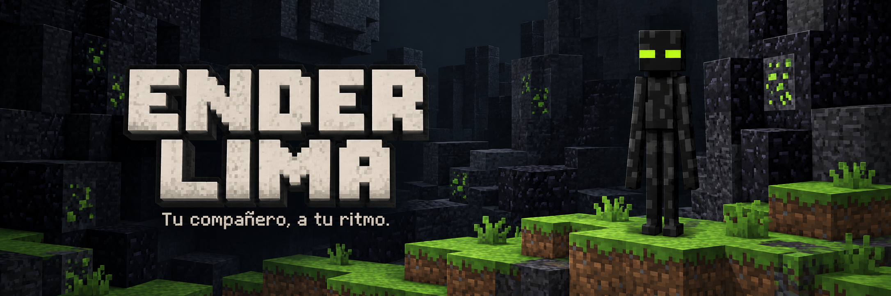
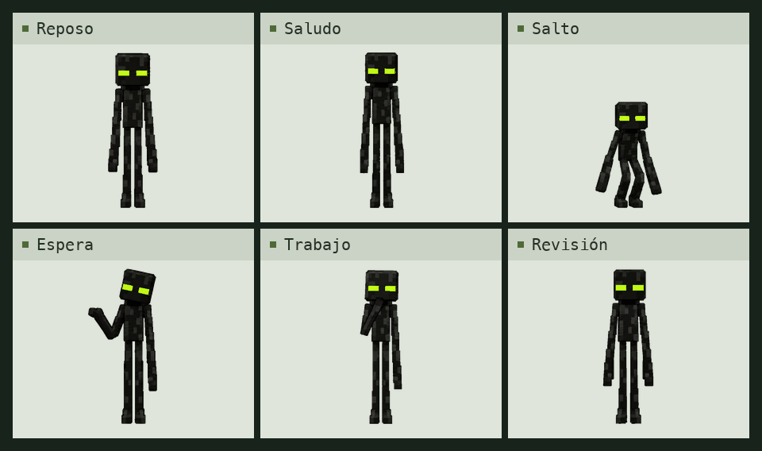

<p align="center">
  
</p>

<p align="center">
  <sub><strong>9</strong> animaciones &nbsp; · &nbsp; <strong>16</strong> miradas &nbsp; · &nbsp; <strong>73</strong> fotogramas</sub>
</p>

<p align="center">
  <a href="recursos/spritesheet.png"><strong>Descargar atlas</strong></a> &nbsp; / &nbsp;
  <a href="vistas-previas/animaciones.mp4">Ver vídeo</a> &nbsp; / &nbsp;
  <a href="vistas-previas/look-loop.gif">Ver miradas</a>
</p>

## En movimiento

Una mascota de cuerpo negro y ojos verde lima que saluda, espera y te acompaña mientras trabajas.

<picture>
  <source media="(max-width: 600px)" srcset="vistas-previas/galeria-movil.gif">
  
</picture>

<p align="center">
  <sub>Animaciones del atlas final, reunidas en una sola vista.</sub>
</p>

<br>

## Los archivos, a mano

**[Atlas transparente](recursos/spritesheet.png)** &nbsp; PNG v2 de 1.536 × 2.288 píxeles, listo para un flujo de importación compatible.

**[Todas las animaciones](vistas-previas/)** &nbsp; GIF individuales, secuencia completa, salto y vídeo MP4.

**[Especificación](recursos/especificacion.json)** &nbsp; Distribución de las filas, tamaños y direcciones de mirada.

<br>

<details>
<summary><strong>Detalles del atlas</strong></summary>

<br>

| Propiedad | Valor |
| :--- | :--- |
| Formato | PNG RGBA transparente, versión 2 |
| Dimensiones | 1.536 × 2.288 píxeles |
| Celdas | 192 × 208 píxeles |
| Distribución | 8 columnas y 11 filas |
| Contenido | 73 fotogramas y 15 celdas vacías |

Las primeras nueve filas contienen reposo, carrera hacia la derecha, carrera hacia la izquierda, saludo, salto, reacción de error, espera, trabajo y revisión. Las dos últimas reúnen las 16 miradas en sentido horario.

[Ver la secuencia completa](vistas-previas/all-states.gif) · [Ver el salto](vistas-previas/idle-jump-idle.gif)

</details>

<details>
<summary><strong>Verificación y seguridad</strong></summary>

<br>

Con Python 3.9 o posterior, sin dependencias adicionales:

```bash
python3 scripts/verificar.py
```

Comprueba las sumas SHA-256, la estructura del atlas, la transparencia de las celdas y los enlaces locales. También busca patrones comunes de credenciales y rutas personales. La revisión es acotada; no garantiza detectar cualquier secreto posible. Los números de este README se pueden contrastar con este comando y la [especificación](recursos/especificacion.json).

La calidad de los gestos y del movimiento requiere revisión visual.

[Sumas de comprobación](recursos/sha256.json) · [Política de seguridad](SECURITY.md)

</details>

<br>

Este repositorio contiene recursos gráficos. No instala ni activa la mascota en una cuenta.

<p align="center">
  <sub>Arte creado con imagegen. Proyecto independiente. <a href="NOTICE.md">Procedencia y condiciones de uso</a>.</sub>
</p>
