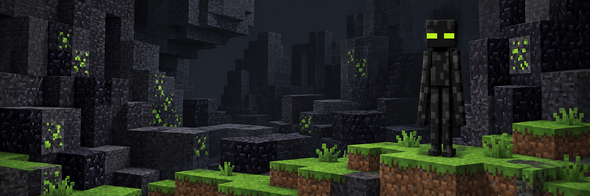
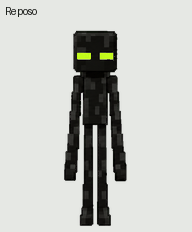

# Ender Lima

Mascota animada con ojos verde lima.



**9 animaciones · 16 direcciones de mirada · 73 fotogramas**

[Vista previa](#vista-previa) · [Archivos](#archivos) · [Verificación](#verificación) · [Alcance](#alcance)

## Vista previa



[Ver vídeo](vistas-previas/animaciones.mp4) · [Ver el salto](vistas-previas/idle-jump-idle.gif) · [Ver las miradas](vistas-previas/look-loop.gif)

Ender Lima es una mascota de cuerpo negro, cabeza cúbica y extremidades largas. Este repositorio reúne el atlas transparente y sus vistas previas. La ambientación de bloques se limita al diseño gráfico; los archivos se describen en español.

## Archivos

| Archivo | Contenido |
| :--- | :--- |
| [Atlas de animación](recursos/spritesheet.png) | PNG transparente de 1.536 × 2.288 píxeles, formato v2. |
| [Estados](recursos/estados.png) | Ejemplos de reposo, saludo, salto, trabajo y revisión. |
| [Animaciones](vistas-previas/) | GIF por estado, secuencia completa y vídeo MP4. |
| [Especificación](recursos/especificacion.json) | Dimensiones, distribución y cantidad de fotogramas. |
| [Sumas de comprobación](recursos/sha256.json) | Integridad de los recursos y las vistas previas. |

## Animaciones

| Estado | Fotogramas | Vista previa |
| :--- | ---: | :--- |
| Reposo | 6 | [GIF](vistas-previas/idle.gif) |
| Carrera hacia la derecha | 8 | [GIF](vistas-previas/running-right.gif) |
| Carrera hacia la izquierda | 8 | [GIF](vistas-previas/running-left.gif) |
| Saludo | 4 | [GIF](vistas-previas/waving.gif) |
| Salto | 5 | [GIF](vistas-previas/jumping.gif) |
| Reacción de error | 8 | [GIF](vistas-previas/failed.gif) |
| Espera | 6 | [GIF](vistas-previas/waiting.gif) |
| Trabajo | 6 | [GIF](vistas-previas/running.gif) |
| Revisión | 6 | [GIF](vistas-previas/review.gif) |

Las dos últimas filas del atlas contienen las 16 direcciones de mirada, en sentido horario. Cada celda mide 192 × 208 píxeles. Las celdas restantes permanecen transparentes.

## Verificación

Con Python 3.9 o posterior, sin dependencias adicionales:

```bash
python3 scripts/verificar.py
```

El comando comprueba las sumas SHA-256, la estructura y transparencia del atlas, los 73 fotogramas requeridos, las 15 celdas vacías y los enlaces locales del README. También revisa los nombres y el contenido de los archivos incluidos para detectar patrones comunes de credenciales y rutas personales. Esta revisión es acotada; no garantiza detectar cualquier secreto posible.

## Alcance

Este repositorio contiene recursos gráficos. No es un mod, no incluye un servidor ni ejecuta servicios de red. No instala ni selecciona la mascota en una cuenta. La portada es una ilustración; las vistas previas proceden del atlas final.

La verificación local confirma integridad y estructura. La interpretación de los gestos y la calidad de movimiento requieren revisión visual.

## Procedencia y privacidad

El arte se creó con imagegen y el atlas se ensambló a partir de los fotogramas aprobados. Se excluyeron archivos de sesión, identificadores de cuenta o mascota, rutas locales, enlaces temporales, credenciales y material de trabajo descartado. Consulta [SECURITY.md](SECURITY.md) para el alcance de la revisión y [NOTICE.md](NOTICE.md) para la procedencia.
